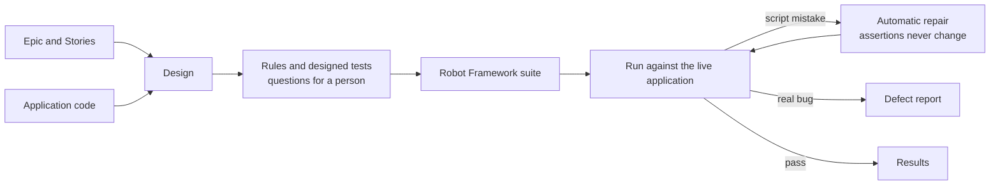

# Stories to E2E: demo

Turn written requirements (Epics and Stories) plus the application's code into **reviewed, executable end-to-end
tests**, run them, repair script mistakes automatically, and report real product bugs.

This repository is a **demo of the results**. It contains sample outputs and a short explanation of the approach.
The tool itself is not part of this repository.

Watch with a voice-over: [short cut, 47 seconds](docs/img/replay-short.mp4) or [full version, 1 minute 45 seconds](docs/img/replay.mp4).

_The replay is a rendering of real output from the run described below. It is not a live recording._

## What it does

1. **Reads the requirements and the code** and extracts the business rules, noting whether each comes from the
   requirement, the code, or both.
2. **Asks, never guesses.** Where the requirement and the code disagree, it raises a question for a person.
3. **Designs the tests** and checks that every rule is covered by at least one.
4. **Generates a Robot Framework suite**: standard, open-source, readable by any test engineer.
5. **Runs it** against the live application and sorts every failure: environment problem, script mistake, or
   product defect.
6. **Repairs script mistakes** by itself. It never changes or removes an assertion, so a green result means the
   application really behaves as specified.
7. **Reports product defects** with what was expected, what happened and steps to reproduce.

More detail: [how it works](docs/how-it-works.md).

## Results on a public application

The demo target is [Spring PetClinic REST](https://github.com/spring-petclinic/spring-petclinic-rest), the Owners
Epic (three Stories plus Epic-level tests).

| Measure | Result |
|---|---|
| Rules extracted from the Epic and the code | 26 |
| Rules covered by at least one test | 26 of 26 (100%) |
| Questions raised where story and code disagreed | 15 |
| Tests designed and implemented | 37 |
| Tests passing in the final run | 33 |
| Tests failing in the final run | 4, all caused by the same defect |

**The defect.** Four tests expect a refusal (403) for a user without the `OWNER_ADMIN` role. The application's own
code says that role is required, but the application as started enforces no roles, so it accepts the request. The
tool reported four product defects and did not edit the tests to pass. See the
[defect report](samples/defect-report.md).

**Two runs, shown separately.** The replay and the numbers above refer to two different runs of the same suite:

- *First run of the 37-test design:* 27 passed, 4 repaired automatically, 4 reported as product defects, 2 script
  defects left, 0 not run (27 + 4 + 4 + 2 + 0 = 37). Of those 4 "defects", three were the role checks below and one
  was a test that expected 200 where the application correctly answers 204: a script error that was counted as a
  defect and fixed afterwards.
- *Final run, after fixing the remaining script problems:* 33 passed, 0 repaired, 4 product defects, 0 script
  defects left, 0 not run (33 + 4 = 37).

## Samples

- [Final run summary](samples/run-summary.txt)
- [Defect report](samples/defect-report.md)
- [Designed tests, excerpt](samples/test-cases-excerpt.md)
- [Questions raised, excerpt](samples/questions-excerpt.md)

## Honest limits

- **API tests only.** The demo application has no UI of its own, so browser tests are not shown.
- **The 15 answers were proposed by Claude from what the code does**, not by a product owner. In real use a product
  owner confirms them.
- **The 4 role tests need two logins** (an admin and a non-admin) to be a complete check; with one login they show
  that the application does not enforce the role.
- **Login support** for the application under test has been tested only against a fake API, not a real login.
- **One Epic of one application** has been run end to end.

## Credits and licence

- [MIT licence](LICENSE).
- Demo target: [Spring PetClinic REST](https://github.com/spring-petclinic/spring-petclinic-rest) (Apache-2.0). The
  samples quote paths and wording from its public source. It is not part of this repository.
- Built with [Claude Code](https://claude.com/claude-code).
- Questions or work enquiries: [Mallikarjun-Auto on GitHub](https://github.com/Mallikarjun-Auto).
