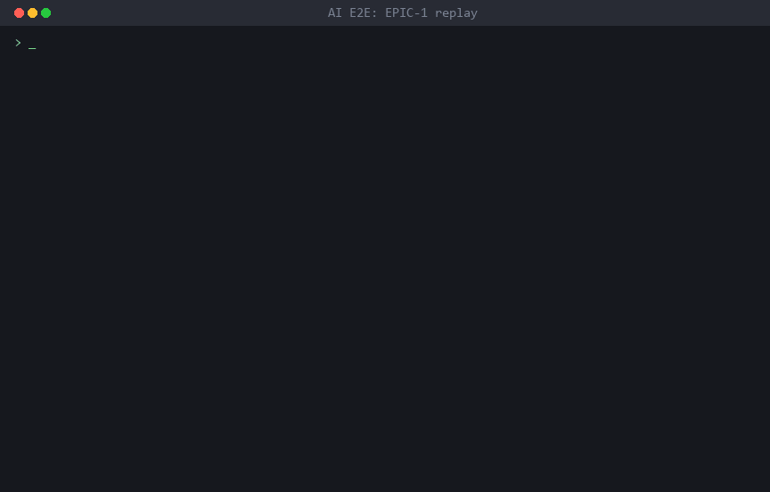
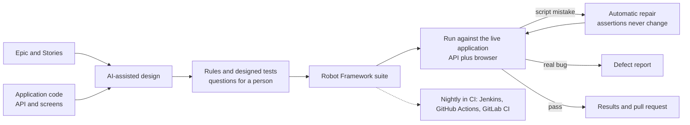
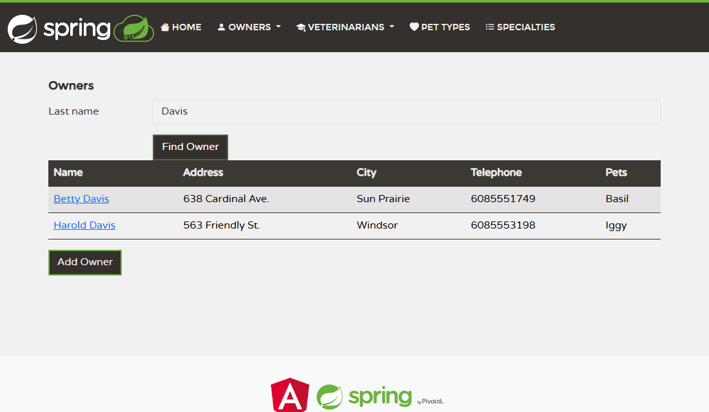
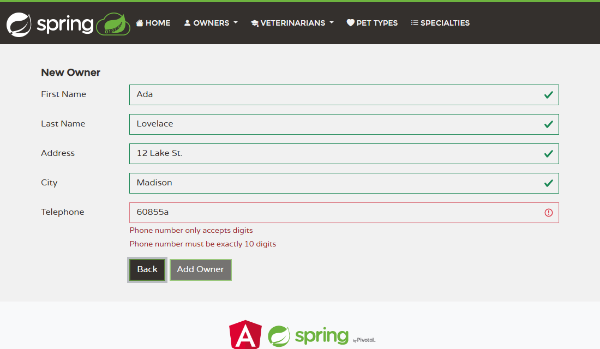

# Stories to E2E: demo

An **AI-assisted** tool that turns written requirements (Epics and Stories) plus the application's code into **reviewed, executable end-to-end
tests**, for the API **and the screens**. Run them, repair script mistakes automatically, and report real product bugs.
The browser tests run on **Playwright or Selenium**: the client picks one, the tests stay the same.

This repository is a **demo of the results**. It contains sample outputs and a short explanation of the approach.
The tool itself is not part of this repository.

Watch with a voice-over, API and screens: [short cut, about 1 minute](docs/img/replay-short.mp4) or [full version, about 2.5 minutes](docs/img/replay-full.mp4).

_The replay is a rendering of real output from the runs described below. It is not a live recording._

## What it does

1. **Reads the requirements and the code** (API and screen templates) and extracts the business rules, noting
   whether each comes from the requirement, the code, or both.
2. **Asks, never guesses.** Where the requirement and the code disagree, it raises a question for a person.
3. **Designs the tests** and checks that every rule is covered by at least one.
4. **Generates a Robot Framework suite**: standard, open-source, readable by any test engineer. Screen tests use
   one neutral set of actions, so the same suite runs on **Playwright** or on **Selenium** with a single setting.
5. **Runs it** against the live application and sorts every failure: environment problem, script mistake, or
   product defect.
6. **Repairs script mistakes** by itself (the AI proposes, plain code checks). It never changes or removes an assertion, so a green result means the
   application really behaves as specified.
7. **Reports product defects** with what was expected, what happened and steps to reproduce.
8. **Runs continuously.** The suite is plain Robot Framework, so it runs nightly or on every change in Jenkins (open
   source), GitHub Actions or GitLab CI, and the reports are archived with each run.

More detail: [how it works](docs/how-it-works.md).

## Results on a public application

The demo target is [Spring PetClinic REST](https://github.com/spring-petclinic/spring-petclinic-rest) and its
[Angular front-end](https://github.com/spring-petclinic/spring-petclinic-angular), the Owners area.

### 1. API tests (Epic "Owners")

| Measure | Result |
|---|---|
| Rules extracted from the Epic and the code | 26 |
| Rules covered by at least one test | 26 of 26 (100%) |
| Questions raised where story and code disagreed | 15 |
| Tests designed and implemented | 37 |
| Tests passing in the final run | 33 |
| Tests failing in the final run | 4, all caused by the same defect |

### 2. Screen and API tests together (Epic "Owner screens")

| Measure | Result |
|---|---|
| Rules extracted from the Epic, the screens and the code | 45 |
| Rules covered by at least one test | 45 of 45 (100%) |
| Questions raised where the story and the real screens disagreed | 12 |
| Tests designed and implemented | 50 (31 screen tests, 3 screen plus API, 16 API) |
| Passing in the final run, **Playwright** | 44 |
| Passing in the final run, **Selenium** (same suite, same database) | 44 |
| Failing in both | 6, all caused by the same defect |

_The second screen shows why the tool asks questions: the written requirement says the inline error reads "Telephone
must be 10 digits"; the real screen shows two messages, "Phone number only accepts digits" and "Phone number must be
exactly 10 digits"._

**The defect behind the failures.** Tests expect a refusal (401 or 403) for a user without the `OWNER_ADMIN` role.
The application's own code says that role is required, but the application as started enforces no roles, so it
accepts the request. The tool reported 3 product defects in the screens run and 4 in the API run, and did not edit
any test to pass. In the screens run, 3 more tests fail for the same reason but their checks sit inside an action
step, so the tool lists them as "unresolved script defects" instead of product defects. See the
[defect report](samples/ui-defect-report.md).

**A second finding, made on the way.** Deleting an owner who still has pets silently deletes the pet types those pets
use, and with them every pet of that type. Written up with a short reproduction:
[docs/finding-owner-delete-removes-pet-types.md](docs/finding-owner-delete-removes-pet-types.md).

**Runs, shown separately.** Counts differ between runs because the suite was repaired and fixed between them:

- *Owners API suite, first run of the 37-test design:* 27 passed, 4 repaired automatically, 4 reported as product
  defects, 2 script defects left, 0 not run (27 + 4 + 4 + 2 + 0 = 37). One of those 4 "defects" was a test that expected
  200 where the application correctly answers 204: a script error that was counted as a defect and fixed afterwards.
- *Owners API suite, final run:* 33 passed, 4 product defects (33 + 4 = 37).
- *Screens suite, first run that could repair itself:* 34 passed, 9 repaired automatically, 4 product defects,
  3 script defects left, 0 not run (34 + 9 + 4 + 3 = 50).
- *Screens suite, final runs (Playwright and Selenium, each):* 44 passed, 3 product defects, 3 unresolved script
  defects (44 + 3 + 3 = 50).

## Samples

API tests:
- [Final run summary](samples/run-summary.txt)
- [Defect report](samples/defect-report.md)
- [Designed tests, excerpt](samples/test-cases-excerpt.md)
- [Questions raised, excerpt](samples/questions-excerpt.md)

Screen tests:
- [Final run summaries, Playwright and Selenium](samples/ui-run-summary.txt)
- [Defect report](samples/ui-defect-report.md)
- [Designed screen tests, excerpt](samples/ui-test-cases-excerpt.md)
- [Questions raised on the screens, excerpt](samples/ui-questions-excerpt.md)

## Credits and licence

- [MIT licence](LICENSE).
- Demo target: [Spring PetClinic REST](https://github.com/spring-petclinic/spring-petclinic-rest) and
  [Spring PetClinic Angular](https://github.com/spring-petclinic/spring-petclinic-angular) (Apache-2.0). The samples
  quote paths, wording and screens from their public source. They are not part of this repository.
- Built with [Claude Code](https://claude.com/claude-code).
- Questions or work enquiries: LinkedIn **MALLIKARJUN B N**, email mallikarjunbn534@gmail.com, or
  [Mallikarjun-bn on GitHub](https://github.com/Mallikarjun-bn).
