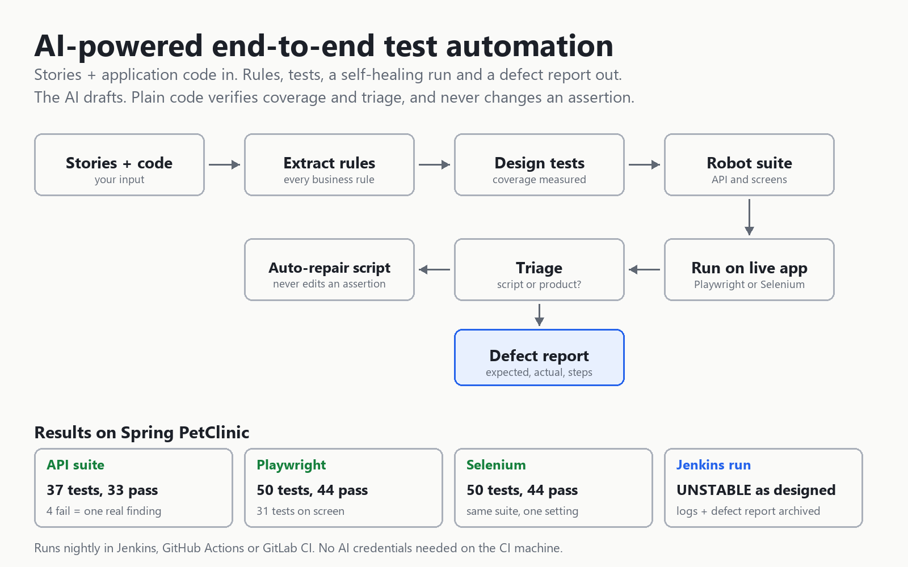

# AI-powered E2E test automation: project overview

## Summary

This tool turns user stories plus application code into reviewed, runnable end-to-end tests, runs them, repairs script
mistakes by itself and reports real product defects. On Spring PetClinic it designed 37 API tests (33 pass, 4 fail on one
real finding) and 50 API-plus-screen tests (44 pass on both Playwright and Selenium). The AI drafts; plain code verifies
coverage, triage and that no assertion is ever changed to get a green.

## The problem it solves

Writing end-to-end tests by hand takes weeks, and the tests still miss rules that live only in the code. Teams also lose
time repairing brittle scripts after every application change. This tool extracts every business rule from the stories and
the code, designs tests, measures how much of the requirement they cover, and asks a person wherever the story and the code
disagree instead of guessing.

## How it works

Stories and code become rules and designed tests, then a Robot Framework suite that runs on the live application. Triage
sends script mistakes to automatic repair and product defects to a report with expected result, actual result and steps to
reproduce. See [how-it-works.md](how-it-works.md) for the stages.

## Results on Spring PetClinic

| Suite | Rules | Tests | Result | Notes |
| --- | --- | --- | --- | --- |
| API (EPIC-1) | 26 | 37 | 33 pass, 4 fail | The 4 failures are one finding: a security check the code requires is skipped |
| Screens + API, Playwright (EPIC-4) | 45 | 50 (31 on screen) | 44 pass | 12 questions raised where story and real screens disagree |
| Screens + API, Selenium (EPIC-4) | 45 | 50 (31 on screen) | 44 pass | Same suite, one setting changed |

The 6 failures on screens share one cause: the application never enforces the admin role. The first browser run needed 9
automatic script repairs (wrong selectors, wrong data, limits the browser enforces first).

## Continuous running

The generated suite is plain Robot Framework, so it runs in any CI system. A Jenkinsfile and a GitHub Actions workflow
exist in the private project. They run a chosen Epic nightly or on demand with `e2e run EPIC-N --no-heal`, so the CI machine
needs no AI credentials: the AI creates and repairs the suite, and CI only runs it.

The Jenkinsfile was run for real on a local Jenkins 2.516.3 (Windows, Java 17) against live PetClinic: 33 of 37 passed, 4
product defects, and the build finished UNSTABLE as designed, with the Robot logs and defect report archived. That run found
and fixed two bugs (Linux-only paths, a Timestamper plugin dependency).

Not yet verified: a Linux agent, screen tests inside Jenkins, and the GitHub Actions workflow.

## Limits and next steps

Results come from one open-source application, and the product defects found are that application's own missing role
checks. Next steps: run screen tests inside Jenkins, run the GitHub Actions workflow on a real runner, and try a Linux agent.
